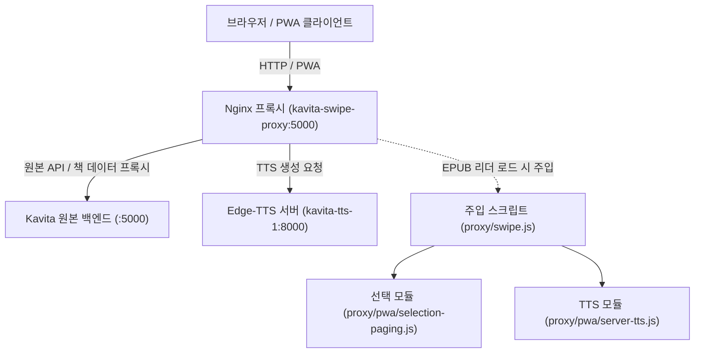
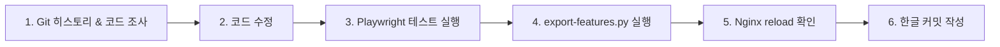

# AI 유지보수 및 프로젝트 인수인계 가이드

> [!IMPORTANT]
> **AI 작업 원칙 1순위: 모든 Git 커밋 메시지 및 프로젝트 기록은 반드시 한글로 작성합니다.**
> 어떤 시점에 어떤 AI 모델이나 세션이 투입되더라도, 이전 대화 맥락에 의존하지 않고 **Git 로그와 본 문서**를 통해 프로젝트의 히스토리와 설계 의도를 즉시 파악하고 안전하게 유지보수를 이어갈 수 있어야 합니다.

---

## 1. 새 세션 진입 시 필수 확인 절차 (AI 체크리스트)

새로운 AI 세션이 시작되면 아무것도 가정하지 말고 아래 순서대로 실제 상태를 먼저 파악하세요.

1. **Git 상태 및 최근 변경 히스토리 확인**:
   ```bash
   git status
   git log -n 10 --oneline
   ```
   - 최근 작업 흐름과 커밋 의도를 파악합니다.
   - **주의**: `선택범위-이어가기-수정요청.md` 등 사용자가 남긴 미추적 요청 문서는 **절대 커밋하거나 삭제하지 마세요**.
2. **실행 중인 Docker 컨테이너 및 인프라 확인**:
   ```bash
   docker ps
   ```
   - `kavita-swipe-proxy` (외부 포트 5000 -> 80)
   - `kavita` (내부 Kavita 백엔드)
   - `kavita-tts-1` (내부 포트 8000, 고품질 Edge-TTS)
3. **핵심 기능 파일 점검**:
   - `proxy/swipe.js`: 메인 스와이프, 하단 정보 바, 페이지 계산, TTS UI
   - `proxy/pwa/selection-paging.js`: EPUB 텍스트 선택 보호, 상하단 끝 0.8초 체류 페이징, 웹 보조 손잡이('시작'·'끝')
   - `proxy/pwa/server-tts.js`: 서버 Edge-TTS 스트리밍 클라이언트
   - `scripts/export-features.py`: 포터블 패키지 및 서비스 워커 동기화 스크립트

---

## 2. 프로젝트 핵심 아키텍처

Kavita 원본 바이너리를 직접 수정하지 않고, **Nginx 리버스 프록시를 통해 웹 리더 자바스크립트를 주입/확장**하는 구조입니다.



### 볼륨 마운트 구조
- 책 파일: `~/kavita/books` -> 컨테이너 `/books`
- 데이터베이스 & 설정: `~/kavita/config` -> 컨테이너 `/kavita/config` (SQLite DB)
- **절대 주의**: `docker compose down -v`나 볼륨 디렉토리 삭제는 절대 금지되어 있습니다.

---

## 3. Git 로그를 통한 히스토리성 파악 가이드

프로젝트의 기능과 버그 수정은 모두 Git 히스토리에 누적되어 있습니다. 새 AI는 다음 명령어로 맥락을 추적해야 합니다.

### 유용한 Git 탐색 명령어
```bash
# 1. 최근 커밋 요약 확인 (한글 커밋 메시지로 의도 파악)
git log -n 15 --oneline

# 2. 특정 파일의 최근 변경 상세 내역 추적
git log -p -n 3 proxy/pwa/selection-paging.js

# 3. 특정 키워드/함수가 언제 추가되거나 수정되었는지 추적
git log -S "touchUI" -p proxy/pwa/selection-paging.js
git log -S "kavita-tts-panel" -p proxy/swipe.js

# 4. 특정 커밋의 전체 diff 확인
git show <커밋ID>
```

### 주요 기능별 진화 히스토리 (마일스톤 맵)

| 시점/커밋 | 구현 내용 및 설계 의도 | 주의점 및 회귀 방지 사항 |
|---|---|---|
| **제스처 및 탭 영역**<br>(초기 ~ `3405393`) | 좌우 스와이프로 페이지 넘김, 가장자리 높이별 탭 영역 (상단 1/3 이전, 하단 2/3 다음), 중앙 20% 메뉴 호출 | 본문 선택, 메모, 링크 클릭 시 터치 제스처가 간섭하지 않도록 제스처 충돌 방지 로직 적용 |
| **전체 페이지 계산 & 하단 바**<br>(`c22a2d8` ~ `ff9f4fb`) | 글꼴·화면비 기준 전체 페이지 수 계산 및 14일 캐싱. 하단 바에 목차, 전체 페이지(`183/450`), 장 진행률 표시 | 목차 클릭 시 목차 서랍(TOC Drawer) 오픈. 하단 바 텍스트가 페이지 번호와 겹치지 않도록 동적 너비 조절 |
| **텍스트 선택 보호 & 상하단 페이징**<br>(`1378ee5` ~ `deb7370`) | 선택 중 원치 않는 가로 스크롤 방지. 상단/하단 끝에서 0.8초 체류(dwell) 시 이전/다음 페이지로 선택 이어가기 | 화면 이동 직후 기존 손가락 위치 때문에 새 페이지 전체가 선택되지 않도록 rebase 좌표 보정 적용 |
| **보조 손잡이 ('시작'·'끝')**<br>(`985c00e` ~ `deb7370`) | Android 기본 OS 핸들이 웹에 포인터 이벤트를 주지 못하는 문제를 해결하기 위해 파란색 웹 보조 손잡이 제공 | 터치뿐만 아니라 마우스/하이브리드 환경에서도 안정적으로 노출되도록 `touchUI` 플래그 및 오버레이 조건 제어 |
| **고품질 서버 Edge-TTS**<br>(`b563bfa` ~ `8f9d780`) | 고품질 신경망 음성(선희·인준·현수) 스트리밍. 상단 메뉴에 [재생/일시정지/정지/설정] 컨트롤 및 자동 팝업 닫기 | 백그라운드 재생 지속, 문장 하이라이트 동기화, 페이지 자동 넘김 및 화면 꺼짐 제어 |
| **다이얼로그 정리 & 손잡이 복구**<br>(`e2594fe`) | TTS 팝업 닫기 시 `<dialog>` 요소를 DOM에서 완전히 제거하여 `geometry()` 무효화 방지 및 손잡이 표시 복구 | HTML `<dialog>`는 `.close()`만 하면 DOM에 남아 `[role="dialog"]` 쿼리에 잡히므로 반드시 `.remove()` 수행 |

---

## 4. 작업 표준 절차 (AI 작업 수칙)

새 기능을 개발하거나 버그를 수정할 때는 반드시 다음 절차를 엄격히 준수합니다.



### 1단계: 원본 소스 수정
- 수정 대상 파일: `proxy/swipe.js`, `proxy/pwa/selection-paging.js`, `proxy/pwa/server-tts.js`, `proxy/pwa/offline/`
- **주의**: `portable-features/` 내부 파일을 직접 손으로 고치지 말고, 반드시 `proxy/`의 원본 파일을 수정한 후 4단계 스크립트로 동기화합니다.

### 2단계: 회귀 테스트 실행
Node 환경 경로를 지정하여 Playwright 기반 테스트를 실행합니다:
```bash
NODE_PATH=/home/achops1368/docker/chopstube/frontend/node_modules node tests/selection-web-handles.test.cjs
NODE_PATH=/home/achops1368/docker/chopstube/frontend/node_modules node tests/selection-edge.test.cjs
NODE_PATH=/home/achops1368/docker/chopstube/frontend/node_modules node tests/tts.test.cjs
NODE_PATH=/home/achops1368/docker/chopstube/frontend/node_modules node tests/server-tts-ui.test.cjs
```

### 3단계: 포터블 배포 패키지 및 서비스 워커 동기화
원본 파일 수정 후 반드시 실행합니다:
```bash
python3 scripts/export-features.py
```
- 이 스크립트가 `portable-features/` 복사, 패키지 압축, 체크섬 갱신, 서비스 워커 캐시 버전(`VERSION`) 갱신을 자동으로 처리합니다.

### 4단계: 실시간 프록시 리로드
컨테이너를 재시작하지 않고 Nginx 설정을 즉시 갱신합니다:
```bash
docker exec kavita-swipe-proxy nginx -s reload
```

### 5단계: 한글 Git 커밋 작성
- 커밋 메시지는 반드시 명확하고 직관적인 **한글**로 작성합니다.
- 형식 예시:
  - `기능: EPUB 리더 상단 메뉴에 TTS 재생 제어 버튼 추가`
  - `수정: TTS 팝업 종료 시 다이얼로그 DOM 정리 및 텍스트 선택 손잡이 표시 복구`
  - `문서: AI 유지보수 가이드에 한글 커밋 원칙 및 히스토리 추적 가이드 추가`
- 미추적 사용자 파일(`선택범위-이어가기-수정요청.md` 등)이 스테이징되지 않도록 주의합니다:
  ```bash
  git add proxy/ portable-features/ AI유지보수.md
  git commit -m "한글 커밋 메시지"
  ```

---

## 5. 자주 발생하는 함정과 주의사항 (AI 트러블슈팅 팁)

1. **HTML `<dialog>` 엘리먼트 DOM 잔존 주의**:
   - `dialog.close()`는 화면에서만 숨길 뿐 DOM 트리에서 요소를 제거하지 않습니다.
   - `selection-paging.js` 등에서 `document.querySelector('[role="dialog"]')`나 모달 존재 여부를 검사할 때 닫힌 다이얼로그가 감지되어 본문 지오메트리 계산이 무력화될 수 있습니다.
   - 다이얼로그를 닫을 때는 반드시 `dialog.remove()`를 함께 호출하거나, 지오메트리 검사 시 `dialog[open]` 및 `visibility !== 'hidden'`을 확인하도록 작성하세요.

2. **샌드박스 파일 시스템 권한 (Read-only filesystem)**:
   - CLI 샌드박스에서 `.git` 쓰기나 파일 직접 수정 시 `EROFS` 오류가 발생하면 elevated 권한(`BypassSandbox: true`)으로 해당 단일 명령을 재실행합니다.

3. **서비스 워커 캐싱 주의**:
   - PWA 모드 및 오프라인 모드에서는 브라우저가 이전 JS 코드를 캐싱하고 있을 수 있습니다.
   - `scripts/export-features.py`를 실행하여 서비스 워커 버전을 갱신해야 사용자가 새로고침했을 때 최신 코드가 즉시 반영됩니다.

4. **사용자 데이터 보존 철칙**:
   - `~/kavita/config`와 `~/kavita/books`는 사용자의 실제 서재와 읽기 기록 데이터베이스입니다.
   - 데이터베이스 리셋, 볼륨 삭제, `docker compose down -v`는 어떠한 경우에도 금지됩니다.

---

## 6. 작업 완료 후 사용자 보고 양식

작업을 마친 후 사용자에게 보고할 때는 아래 내용을 빠짐없이 명확하게 전달하세요:
1. **문제 원인 또는 개발한 기능의 핵심 요약**
2. **수정한 파일 목록 및 `export-features.py` 반영 여부**
3. **실행한 테스트 결과 및 라이브 프록시 리로드 상태**
4. **한글 Git 커밋 ID 및 롤백 기준점**
5. **사용자가 브라우저에서 직접 확인할 수 있는 방법**
